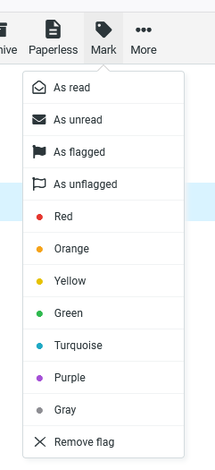
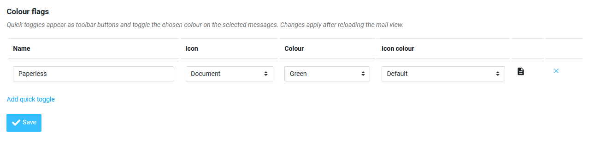

# applecolorflags

Roundcube plugin that shows **Apple Mail colour flags** and lets you set them from Roundcube.

Apple Mail stores flag colours as standard IMAP keywords on top of `\Flagged`:

| Colour    | IMAP flags                         |
|-----------|------------------------------------|
| red       | `\Flagged`                         |
| orange    | `\Flagged $MailFlagBit0`           |
| yellow    | `\Flagged $MailFlagBit1`           |
| green     | `\Flagged $MailFlagBit0 $MailFlagBit1` |
| blue      | `\Flagged $MailFlagBit2`           |
| purple    | `\Flagged $MailFlagBit0 $MailFlagBit2` |
| gray      | `\Flagged $MailFlagBit1 $MailFlagBit2` |

## Screenshots

| Mark menu with colour entries and a quick toggle button | Settings → Colour flags |
|---|---|
|  |  |

## Features

- Coloured flags/rows in the message list
- Colour entries in the "Mark" menu
- User-defined quick toggle toolbar buttons (name, icon, colour) under *Settings → Colour flags*
- Localisation: en_US, de_DE
- Skin: Elastic

## Installation

With Composer (in your Roundcube directory):

```
composer require foorschtbar/applecolorflags
```

Or copy this folder to `plugins/applecolorflags`. Then enable it in `config/config.inc.php`:

```php
$config['plugins'] = [..., 'applecolorflags'];
```

Docker image (`roundcube/roundcubemail`): add `foorschtbar/applecolorflags` to `ROUNDCUBEMAIL_COMPOSER_PLUGINS` and `applecolorflags` to `ROUNDCUBEMAIL_PLUGINS`.

## Releasing

Push a tag (`git tag v1.0.0 && git push origin v1.0.0`). The workflow creates a GitHub release with a zip; Packagist picks up the tag.

## License

MIT
